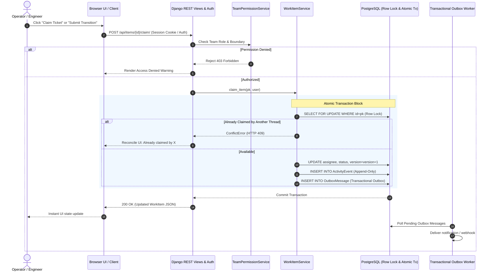

# Newtonite Operations Hub (`newtonite-ops`)

[](#)
[-success)](#)
[](#)
[](#)

A resilient, tested, full-stack operations and incident management platform built for the Newtonite Software Engineering Challenge: **“Operations Under Pressure”**.

---

## 1. Product Overview & Key Features

The **Newtonite Operations Hub** is engineered to handle concurrent, high-stakes operational workflows without data corruption, lost updates, or unauthorized cross-team modifications.

### Core Capabilities
- **Triage & Queue Dashboard**: Dedicated, real-time views for *Assigned to Me*, *Unassigned Urgent Incidents*, and *Awaiting My Approval*.
- **Strict Workflow Lifecycle**: Formal state machine (`Open` &rarr; `In Progress` &rarr; `Awaiting Approval` &rarr; `Resolved` &rarr; `Closed`) with server-side validation and dedicated Team Lead approval gates.
- **Concurrency & Atomic Claim Protection**: Row-level locking (`SELECT ... FOR UPDATE`) guarantees that when two operators race to claim an unassigned incident, exactly one succeeds and the other receives a descriptive conflict error.
- **Optimistic Concurrency Control (OCC)**: Version-checked updates prevent stale overwrites. Conflicting edits return **HTTP 409 Conflict** with server state reconciliation.
- **Idempotency Engine**: Supports client-supplied `Idempotency-Key` headers for ticket creation. Replays cached responses without creating duplicate records.
- **Append-Only Activity Audit Trail**: Atomic audit logging of status shifts, reassignments, priority changes, and comments. Written within the exact same database transaction as the item change.
- **Multi-Tenant Role-Based Access Control (RBAC)**: Fine-grained per-team roles (*Viewer*, *Member*, *Lead*, *Admin*) with strict boundary enforcement for restricted teams.
- **Transactional Outbox Worker**: Zero dual-write asynchronous notification pipeline with exponential backoff and retry limits.
- **Responsive Enterprise Frontend**: Accessible, semantic UI built with Django templates, clean CSS, and client-side reconciliation.

---

## 2. Architecture & Request Flow



---

## 3. Technology Stack & Prerequisites

- **Backend**: Python 3.13+, Django 6.1, Django REST Framework 3.18
- **Database Engine**: PostgreSQL 17 (via `psycopg` 3.3)
- **Frontend**: Django Templates, HTML5, Vanilla CSS (Enterprise design system), JavaScript (ES6)
- **Testing**: `pytest`, `pytest-django`, `pytest-env`
- **Containerization**: Docker Compose (`docker-compose.yml`)

### Environment Prerequisites
- Python 3.11 or higher installed (`python --version`)
- PostgreSQL 14+ running locally or accessible remotely
- *(Optional)* Docker Desktop / Docker Compose

---

## 4. Installation & Local Setup

### Step 1: Clone and Enter Directory
```bash
git clone <repository-url>
cd newtonite-ops
```

### Step 2: Create and Activate Virtual Environment
```powershell
# Windows PowerShell
python -m venv .venv
.\.venv\Scripts\Activate.ps1
```
```bash
# macOS / Linux
python3 -m venv .venv
source .venv/bin/activate
```

### Step 3: Install Dependencies
```bash
pip install -r requirements.txt
```

### Step 4: Configure Environment Variables
Copy `.env.example` to `.env` and verify database credentials:
```bash
cp .env.example .env
```
Default `.env` configuration:
```ini
DJANGO_SECRET_KEY=newtonite-ops-super-secure-dev-key-change-in-prod-2026!
DJANGO_DEBUG=True
DJANGO_ALLOWED_HOSTS=localhost,127.0.0.1,0.0.0.0

DB_ENGINE=django.db.backends.postgresql
DB_NAME=newtonite_ops
DB_USER=postgres
DB_PASSWORD=root
DB_HOST=127.0.0.1
DB_PORT=5432
```

### Step 5: Initialize PostgreSQL Database
Ensure the `newtonite_ops` database exists in PostgreSQL:
```sql
CREATE DATABASE newtonite_ops;
CREATE DATABASE test_newtonite_ops;  -- used for pytest execution
```

### Step 6: Run Migrations and Seed Demo Data
```bash
# Apply schema migrations
python manage.py migrate

# Seed teams, roles, demo users, and realistic operational tickets
python manage.py seed_data
```

### Step 7: Run the Development Server
```bash
python manage.py runserver
```
Visit the application in your browser at: **`http://127.0.0.1:8000/`**

---

## 5. Seeded Demo Accounts

All seeded demo accounts share the development password: **`Newtonite2026!`**

| Username | Role & Team Affiliation | Focus / Use Case |
| :--- | :--- | :--- |
| `admin` | **Superuser & Global Ops Admin** | Complete cross-team access and global administration |
| `lead_payments` | **Team Lead** — *Payments & Billing* | Has Lead authority to approve payment transitions and resolve tickets |
| `member_payments` | **Member** — *Payments & Billing* | Can create, claim, update, and progress tickets to approval |
| `viewer_auditor` | **Viewer** — *Payments & Billing & Security* | External auditor with read-only access; cannot modify tickets |
| `lead_platform` | **Team Lead** — *Platform Core & SRE* | Incident commander for Core SRE incidents |
| `member_platform` | **Member** — *Platform Core & SRE* | Operational engineer for platform tasks |
| `viewer_guest` | **Viewer** — *Platform Core & Customer Support* | Read-only trainee access |
| `lead_security` | **Team Lead** — *Security & Compliance (Restricted)* | Exclusive Lead over the restricted Security team |
| `member_security` | **Member** — *Security & Compliance (Restricted)* | Operates inside the restricted security boundary |
| `member_support` | **Member** — *Customer Support* | Triages customer escalations |

---

## 6. Role-Based Access Control (RBAC) Matrix

| Action | Viewer | Member | Team Lead | Admin / Superuser |
| :--- | :---: | :---: | :---: | :---: |
| **View Unrestricted Team Items** | &#10004; | &#10004; | &#10004; | &#10004; |
| **View Restricted Team Items** | Member only | Member only | Member only | &#10004; |
| **Create Work Item in Team** | &#10008; | &#10004; | &#10004; | &#10004; |
| **Claim Unassigned Item** | &#10008; | &#10004; | &#10004; | &#10004; |
| **Edit Item Permitted Fields** | &#10008; | &#10004; | &#10004; | &#10004; |
| **Add Comment** | &#10008; | &#10004; | &#10004; | &#10004; |
| **Transition `Open` &rarr; `In Progress`** | &#10008; | &#10004; | &#10004; | &#10004; |
| **Transition `In Progress` &rarr; `Awaiting Approval`** | &#10008; | &#10004; | &#10004; | &#10004; |
| **Approve: `Awaiting Approval` &rarr; `Resolved`** | &#10008; | &#10008; | &#10004; (Team Lead) | &#10004; |
| **Reject: `Awaiting Approval` &rarr; `In Progress`** | &#10008; | &#10008; | &#10004; (Team Lead) | &#10004; |
| **Transition `Resolved` &rarr; `Closed`** | &#10008; | &#10004; | &#10004; | &#10004; |

---

## 7. REST API Reference

All API routes require authenticated sessions and return JSON:

- **`GET /health/` / `GET /api/health/`**: Returns system and live PostgreSQL connectivity status.
- **`GET /api/items/`**: List work items with server-side query filters (`?q=`, `?status=`, `?priority=`, `?type=`, `?team=`, `?assignee=`, `?page=`).
- **`POST /api/items/`**: Create work item. Supports `Idempotency-Key` header.
- **`GET /api/items/<id>/`**: Retrieve full item details and permitted next transitions.
- **`PATCH /api/items/<id>/`**: Partial update with optimistic locking precondition (`{"version": <int>}`).
- **`POST /api/items/<id>/claim/`**: Atomically claim an unassigned ticket.
- **`POST /api/items/<id>/transition/`**: Workflow state transition (`{"target_status": "<status>", "note": "<optional>"}`).
- **`GET /api/items/<id>/activity/`**: Append-only audit events timeline.
- **`GET /api/items/<id>/comments/`**: List comments.
- **`POST /api/items/<id>/comments/`**: Post comment (`{"content": "<text>"}`).
- **`GET /api/teams/`**: List teams accessible to current user.
- **`GET /api/teams/<id>/members/`**: List members of a team.
- **`GET /api/auth/whoami/`**: Returns current session identity and team roles.

---

## 8. Transactional Outbox Background Worker

To run the transactional outbox notification processor:
```bash
# Process current pending outbox queue once:
python manage.py process_outbox --once

# Run continuous background worker:
python manage.py process_outbox --interval 2 --batch-size 20
```

---

## 9. Automated Test Suite & Verification Results

The automated test suite runs against the real PostgreSQL database engine to verify true row-level locking, atomic transactions, and concurrency behavior.

### Run All Tests
```bash
pytest -v
```

### Verified Test Results (22 Passed / 0 Failed)
```
============================= test session starts =============================
platform win32 -- Python 3.13.5, pytest-9.1.1, pluggy-1.7.0
rootdir: C:\Users\REAHAN\Desktop\newtonite-ops
configfile: pytest.ini
plugins: django-4.14.0
collected 22 items

tests/test_activity_consistency.py::test_activity_events_written_transactionally PASSED [  4%]
tests/test_activity_consistency.py::test_transactional_rollback_on_activity_failure PASSED [  9%]
tests/test_auth_and_permissions.py::test_unauthenticated_request_rejected PASSED [ 13%]
tests/test_auth_and_permissions.py::test_whoami_endpoint PASSED          [ 18%]
tests/test_auth_and_permissions.py::test_viewer_cannot_create_work_items PASSED [ 22%]
tests/test_auth_and_permissions.py::test_member_can_create_work_items PASSED [ 27%]
tests/test_auth_and_permissions.py::test_cross_team_read_denied_for_restricted_team PASSED [ 31%]
tests/test_auth_and_permissions.py::test_cross_team_write_denied PASSED  [ 36%]
tests/test_comments_and_validation.py::test_comment_creation_and_listing PASSED [ 40%]
tests/test_comments_and_validation.py::test_validation_rules PASSED      [ 45%]
tests/test_concurrency_and_locking.py::test_stale_update_returns_409_conflict PASSED [ 50%]
tests/test_idempotency.py::test_repeated_idempotency_key_creates_only_one_item PASSED [ 54%]
tests/test_outbox.py::test_outbox_event_created_transactionally PASSED   [ 59%]
tests/test_outbox.py::test_outbox_processor_delivers_successfully PASSED [ 63%]
tests/test_outbox.py::test_outbox_processor_retries_and_marks_failed_on_max_attempts PASSED [ 68%]
tests/test_search_filters_pagination.py::test_server_side_search_and_filtering PASSED [ 72%]
tests/test_search_filters_pagination.py::test_deterministic_pagination PASSED [ 77%]
tests/test_workflow.py::test_full_allowed_workflow_lifecycle PASSED      [ 81%]
tests/test_workflow.py::test_invalid_transitions_rejected PASSED         [ 86%]
tests/test_workflow.py::test_non_lead_cannot_approve PASSED              [ 90%]
tests/test_workflow.py::test_lead_rejection_flow PASSED                  [ 95%]
tests/test_concurrency_and_locking.py::test_concurrent_claims_exactly_one_succeeds PASSED [100%]

======================= 22 passed in 300.05s (0:05:00) ========================
```

---

## 10. Known Limitations & Future Work

1. **Native WebSockets**: Current dashboard uses polling and active client reconciliation on actions. Adding Django Channels or Server-Sent Events (SSE) would allow zero-click live updates when other operators claim tickets.
2. **PostgreSQL Full-Text Search Vector (tsvector)**: Currently, search uses `icontains` with composite B-Tree indexes. For databases scaling past 100k items, migrating to a generated `tsvector` column with GIN index will optimize natural language search.
3. **Webhook Signatures for Outbox**: The outbox worker simulates notification dispatch. In a production SaaS setup, adding HMAC-SHA256 signature verification for outbound webhook targets would be recommended.

---

## 11. Publishing to GitHub

To safely publish this project to your designated repository:

1. Create a private or public GitHub repository named: **`newtonite-ops-23scse1420011`** 
2. Ensure you do **NOT** commit any `.env` file containing local credentials. `.gitignore` is already configured to exclude `.env`, `.venv`, and `__pycache__`.
3. Run the following Git commands in your terminal:

```bash
git init
git add .
git commit -m "feat: complete Newtonite Operations Hub implementation with full test suite"
git branch -M main
git remote add origin https://github.com/Rehanraza009/newtonite-ops-23scse1420011.git
git push -u origin main
```
